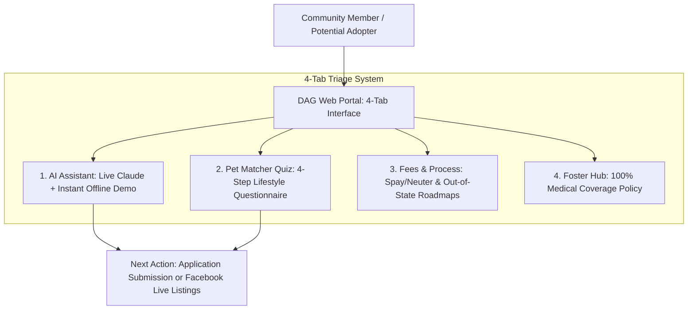

# 🐾 Deming Animal Guardians (DAG) — Civic Rescue Triage & Adoption Playbook
PLAYBOOK.md — Community Operations, Foster SOP & Adoption Protocols

This playbook outlines community triage procedures, adopter qualification criteria, out-of-state transport rules, foster medical sponsorship policies, and anti-hallucination guardrails for **Deming Animal Guardians (DAG)**.

---

## 1. 💼 Executive Overview & Mission

### The Mission
Deming Animal Guardians (DAG) is a non-profit 501(c)(3), all-volunteer animal rescue operating in Luna County, New Mexico. DAG rescues dogs and cats from municipal shelters and rural high-euthanasia areas, placing them in foster homes and providing veterinary care (spay/neuter surgery, core vaccinations, microchipping, and heartworm testing) before finding forever homes.

### The Problem
Volunteer staff spend **15–20 hours per week** fielding the same basic questions via Facebook messages and emails (adoption fees, out-of-state transport, foster medical costs), creating volunteer burnout and delaying critical rescue responses.

### The Automated Solution
A lightweight, mobile-first adoption portal combining an **AI Adoption Assistant**, an interactive **Pet Compatibility Matcher Quiz**, a **Fee & Process Transparency Hub**, and a **Foster Caregiver Onboarding Guide**.

---

## 2. 🏗️ Portal Architecture & Triage Flow

---

## 3. 📋 Standard Operating Procedures (SOP)

### SOP-01: Adoption Process & Fee Schedule
1. **Adoption Application**: Completed online or in person at community events.
2. **Volunteer Review**: Applications reviewed within 24–48 hours for landlord pet policies, veterinary references, and home compatibility.
3. **Meet & Greet**: Arranged at foster location or virtually for out-of-state adopters.
4. **Standard Fee Schedule**:
   * **Dogs & Puppies**: **$100 to $200** (Covers spay/neuter, rabies, DHPP, microchip, heartworm test, deworming).
   * **Cats & Kittens**: **$50 to $100** (Covers spay/neuter, FVRCP vaccines, microchip, FeLV/FIV testing).

### SOP-02: Out-of-State Adoption & Transport Protocol
* DAG actively facilitates adoptions to approved out-of-state homes.
* Requires virtual home/yard walkthrough and veterinarian verification.
* Transport coordinated via volunteer flight relays, ground transport networks, or adopter travel.

### SOP-03: Foster Caregiver Onboarding & 100% Medical Coverage Policy
* DAG is a foster-based rescue.
* **100% Medical Guarantee**: DAG pays for all veterinary examinations, medications, vaccinations, and surgeries at partnered veterinary clinics.
* Foster families provide temporary shelter, food, basic socialization, and love.

---

## 4. 🛡️ Guardrails & Anti-Hallucination Policies

* **Strict Live Inventory Guardrail**: The AI assistant is explicitly forbidden from inventing specific shelter animals or claiming animals are currently in stock. It explains rescue policies factually and routes live animal inquiries to the official **Deming Animal Guardians Facebook Page**.
* **Zero-Cost Civic Hosting**: Runs 100% free on GitHub Pages with zero server bills or infrastructure overhead.

---

## 5. 🚨 Community Exception Handling

| Visitor Inquiry | System Directive | Resolution Pathway |
| :--- | :--- | :--- |
| **Lost or Found Stray Animal** | Directs immediately to Luna County Animal Control & DAG Emergency Intake | Provides local phone numbers and Facebook tag recommendations. |
| **Medical Emergency for Pet** | Informs user DAG is a rescue, not an emergency vet | Refers to local Southwestern NM veterinary emergency clinics. |
| **Low-Income Spay/Neuter Vouchers** | Explains DAG community voucher assistance programs | Directs to DAG website voucher application form. |

---

## 6. 🚀 Deployment & Operational Checklist

- [ ] **Hosting Setup**: Enable GitHub Pages from `main` branch (`/root`).
- [ ] **Custom Domain (Optional)**: Configure CNAME if connecting to official rescue domain.
- [ ] **Dual-Mode Verification**: Confirm instant demo mode operates with zero API keys.
- [ ] **Automated Testing**: Run `pytest tests/` to confirm HTML structure, tab integrity, and guardrail rules.

---

## 7. 💬 Stakeholder FAQ

**Q: Does this cost the rescue anything to operate?**  
*A: No. The system is hosted completely free on GitHub Pages with zero monthly software licenses, server bills, or maintenance contracts.*

**Q: What if a visitor doesn't have an API key?**  
*A: The system automatically runs in Instant Demo Mode, answering all questions about fees, out-of-state adoptions, and foster policies using its built-in knowledge base.*
